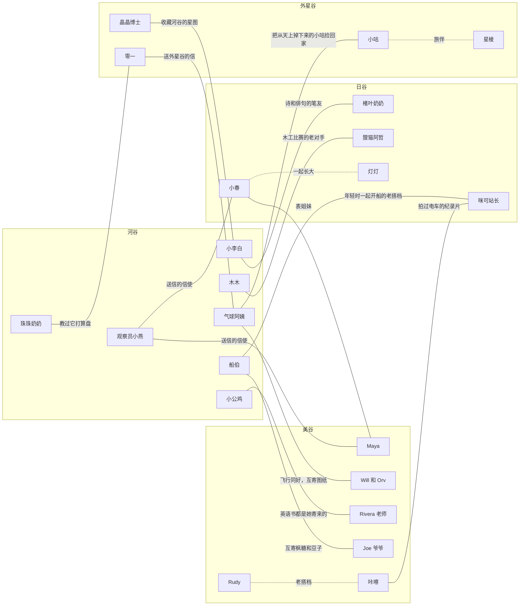
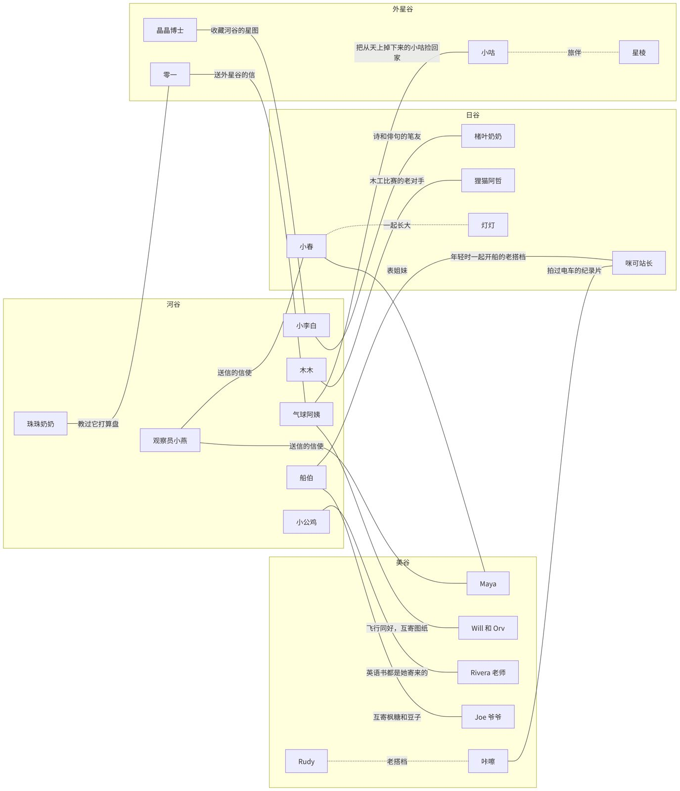
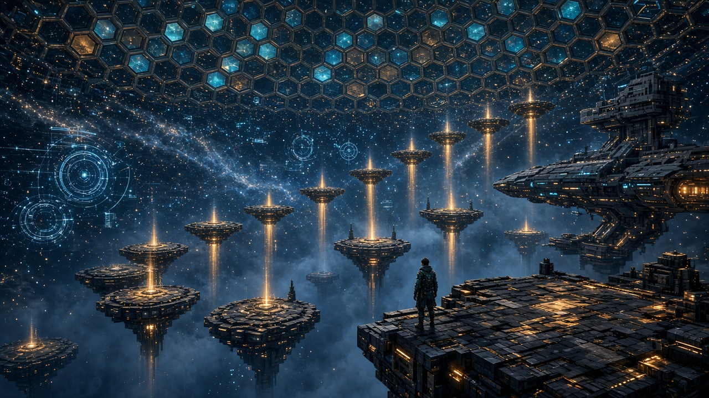
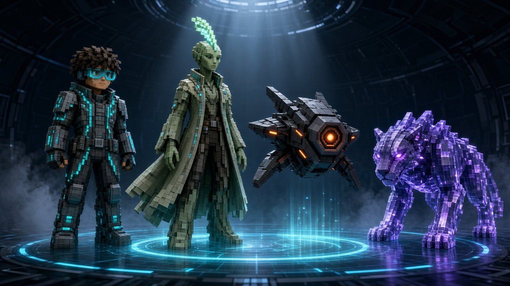
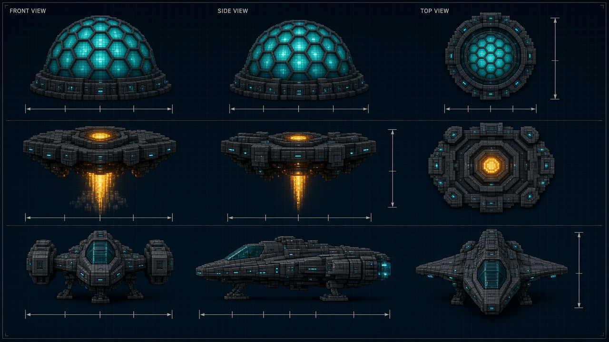
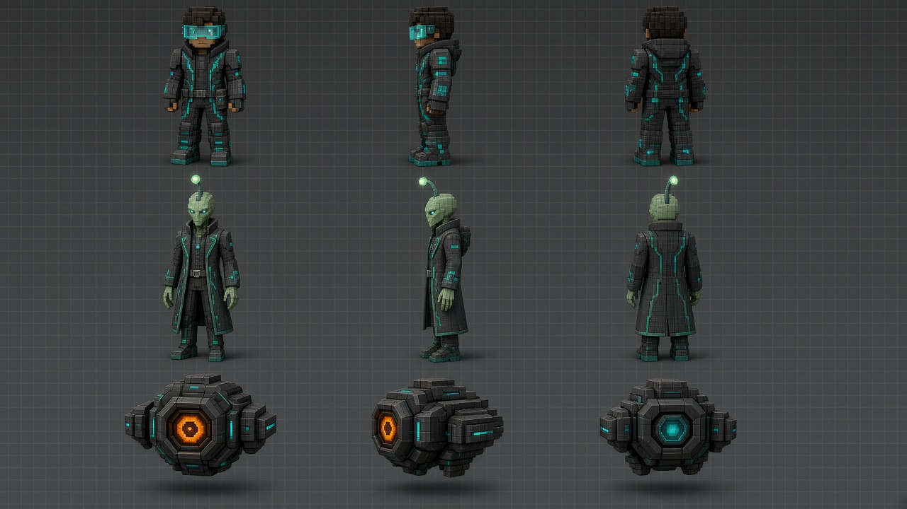

# 《我的河谷》三谷主题设计稿 v0.3.1

> 日期：2026-10-21（北京时间）
> 依据：用户要求「日谷参考日本东京、建筑和经典 IP，美谷参考美国好莱坞、经典建筑和经典 IP，外星谷参考科幻风格和动漫里罗峰的虚拟宇宙」，以及看完第一版概念图后的反馈「过于卡通的，针对 6–12 青少年提升」、「设计相关的建筑和角色原型」、「具备与河谷关联的完整的背景故事线索，方便后续进行跨河谷的引导交互」，以及用户对 9 个问题的回答（见第 6 节）。
> 接续：`多谷世界观与系统设计-v0.2.md`，以及 main 上已经实现的代码（提交 e6283dd，PR #1/#2/#3/#5/#7 已合并）。
> 标记说明：**【沿用】** 现在已有，不动；**【改】** 在现有实现上改外观或扩展；**【新增】** 现在没有的新内容。

---

## 0. 总则

### 0.1 改动记录

**v0.3.1（本版）相对第 2 版的改动**：把用户对 9 个问题的回答写进正文，第 6 节改成「已拍板的决定」。
1. 日谷寺社**只做「点亮石灯笼」**这一种互动（2.3、2.9、5.1）。
2. 美谷山坡大字定为 **USA**（3.3、3.9）。
3. 西部布景和街景布景都做成电影布景，可以绕到背后看木架（定稿）。
4. 星阶上限定为 6–8 岁 6 级、9–12 岁 12 级（定稿）。
5. 年龄改两档，旧存档的 4–6 岁和 7–9 岁都映射到 6–8 岁（0.6）。
6. 孩子用平板玩：加「流畅 / 精美」开关，**平板默认流畅**（0.5）。
7. 河谷新角色（船伯、气球阿姨、珠珠奶奶、木木、观察员小燕）和观星台都要做（1.4）。
8. 故事定稿为 **「星河图」+「拯救河谷」**：玩法是收集星河图碎片，目标是拯救被大雾罩住的河谷。新增 1.2「雾」的规则；每章的「带回河谷后的变化」改成「河谷恢复了哪一块」；三片碎片按任意顺序都能拿；「银线河」标为**未采用**（1.3.1）；存档新增 `travel.story.restored`、`fogIntro`、`fogOff`（1.5）。
9. 开发顺序：先做外星谷，再做序章和观星台，然后日谷和美谷。日语和英语录音先用 AI TTS 生成（2.5、3.5）。

**第 2 版相对第 1 版的改动**
1. **目标年龄改成 6–12 岁**，取消 4–6 岁档，改成两档：**6–8 岁**（刚开始认字，仍然全程有语音和图标提示）和 **9–12 岁**。三个谷的学习任务都重新分到这两档里（见 0.6）。
2. **美术方向整体往上提**：不再用幼儿园式的圆滚滚、Q 版大头和糖果色。改成有体积光、雾和材质感的体素世界，配色更沉稳、对比更强；角色比例接近正常少年，有装备感（见 0.5）。参考的是《塞尔达》《原神》、Minecraft 光影包和《光遇》的**画面水准**，只参考风格。
3. **外星谷优先改**：星网大厅改成宏大的「虚拟宇宙」，有巨大的数据穹顶、全息界面、悬浮修炼平台阵列，星舰有工业设计感。新增**玩家的虚拟化身**、**挑战关卡**和**成长体系**（星阶只跟自己比，不排名，不对打）。小咕、零一重新设计，原来的「噗噗」改成晶甲星豹「星棱」。
4. **日谷改成现代东京街景**：霓虹夜景、高架电车、红白铁塔、斑马线，加上山坡上的传统寺社，参考新海诚电影那种写实又明亮的感觉。
5. **美谷改成好莱坞片场**：电影工作室、摄影棚、经典建筑、黄金时代的影院。
6. **新增第 1 章「世界背景与跨谷故事线」**：主方案「星河图」和备选方案「银线河」（v0.3.1 定稿为「星河图」+「拯救河谷」，「银线河」未采用），分章主线、终章、跨谷角色关系图和跨谷引导规则，以及新谷接入模板。
7. **新增第 5 章「建筑与角色原型」**：每个谷 3 个建筑和 3 个角色，写清三视图尺寸、分层、材质、交互点和动画状态。配套原型设定图（`img/*-proto.jpg`）和可以在手机上转着看的 3D 原型（`prototype/`）。
8. 概念图全部重画，文件名加 `-v2`；第 1 版的图保留在 `img/` 里，不再引用。

**第 1 版**：第一次写三谷主题（东京、好莱坞、虚拟宇宙），每个谷有地标、角色、学习、节日、进入方式和 IP 对照表。

### 0.2 不变的规则
- 河谷是家，不点明是哪个国家。
- 去外谷靠渡口和热气球：日谷、美谷两种都能去，外星谷只能坐热气球。
- 节日可以放进游戏，但只改装饰和氛围；相关手工全年都能做，没有限时奖励、签到和限定物品。
- 答题一律可选，跳过不扣东西。6–8 岁档每一步都有语音和图标，不认字也能走完。
- 外谷场景里，玩家只能在「访客小院」（`visitor` 区域）里放方块；地标是**场景件**，不占玩家的 600 方块额度（`REALM_BLOCK_LIMIT`）。
- 外星谷是虚构文明，标「幻想」；物理规律和地球一样，只换参数（重力 1/3）。
- 不做恐怖和暴力：没有敌人、血量、打斗；悬念来自「谜」和「发现」，不来自「危险」。

### 0.3 版权与 IP 原则（仓库是公开的）
1. 经典 IP 只拿来参考**风格、氛围、类型**，比如「特摄的变身感」「好莱坞首映夜的红毯感」「虚拟宇宙的数据星空感」「新海诚的光」。
2. 游戏里的**角色、名字、造型、Logo、台词、配乐全部原创**。不出现任何版权角色、作品名、公司名或商标；不做「换个颜色的某某」。
3. 真实建筑可以参考外形，但**游戏里一律用原创名字**，比如「红白铁塔」而不是「东京塔」。知识卡里讲真实建筑时，可以写真实名字和事实。
4. 「灵感来自 X」只写在文档里，不进游戏文本、不进素材文件名。
5. 不画真实的人。概念图和设定图只当方向参考，不直接作为游戏素材入库。
6. 每个谷都有一张「灵感参考 → 原创转化」对照表。

### 0.4 空间约定（对照现有代码）
- 每个外谷场景都是 32×32 格（`bounds` 为 -16 到 15），渡口在南边 `z=-12` 一带，热气球草坪在 `(-10, 12)`。
- 1 格 = 1 个游戏方块 = three.js 里的 1 个单位（和 `world.js` 的 `BoxGeometry(1,1,1)` 一致）。角色身高约 1.7 格。
- 地标分三层：
  - **近景层**：在 32×32 格里面，可以走近、可以点。底面控制在 10×10 格以内。
  - **中景层**：在场景边缘，比如山坡、海湾、高架桥，能看见但走不过去。
  - **远景层**：场景外的低细节剪影，做法和 `vista-view.js` 一样（一个合并网格），比如雪山、城市天际线、数据穹顶的外圈。
- 高的地标（20 格以上）放在边缘，免得挡住默认视角（PR #7 刚恢复的视角：地面 pitch .76）。

### 0.5 美术总方向（三个谷通用）
| 项 | 第 1 版 | 第 2 版 |
| --- | --- | --- |
| 整体 | 圆角方块，糖果色，幼儿绘本感 | 仍是方块和体素世界，但有**体积光、雾、材质感**；像「开了光影包的方块世界」 |
| 配色 | 高饱和粉、薄荷、柠檬黄 | 沉稳的底色（藏青、石墨、暖木、砖红）+ 少量高亮点缀（霓虹、灯泡、全息青）；明暗对比强 |
| 光 | 平光，几乎没有阴影 | 太阳斜光、长影子、雾里的光柱；夜晚靠自发光（窗户、灯笼、霓虹、全息）撑起画面 |
| 材质 | 纯色 | 木纹、砖缝、金属的反光、湿地面的倒影、半透明玻璃和全息面板 |
| 角色 | Q 版大头、婴儿脸 | **约 6 头身**的少年比例；脸是简洁的体素五官，不夸张；有装备感（外套、背包、护目镜、工装） |
| 动物角色 | 圆滚滚的吉祥物 | 直立的「兽族」少年或成年人，穿衣服、有职业，比例修长 |

**three.js 实现要点**（给开发参考，原型页已经按这套做了）：
- 色调映射用 `ACESFilmicToneMapping`，开阴影（`PCFShadowMap`；three.js r186 已经去掉了 `PCFSoftShadowMap`）。
- 雾用 `FogExp2`，每个谷的雾色不同：日谷蓝紫，美谷琥珀，外星谷深海蓝。
- 「体积光」用加法混合的半透明锥体或平面假做，不做真正的光线步进。
- 自发光用材质的 `emissive`；精美档加 `UnrealBloomPass` 泛光。
- 材质用 `MeshStandardMaterial` 调 roughness 和 metalness，加 64×64 的程序噪声贴图做颗粒感。
- **分两档画质**：「流畅」关掉泛光，阴影贴图减半；「精美」全开。**平板默认「流畅」**，孩子可以在设置里改（已拍板，见第 6 节第 6 条）。

### 0.6 年龄档（6–8 / 9–12）
| 项 | 6–8 岁 | 9–12 岁 |
| --- | --- | --- |
| 读字 | 刚开始认字：**每句话都有语音**，按钮全部是图标，文字只是辅助 | 能读短段落；语音可以关 |
| 任务 | 一步一个提示，看得见目标（发光描边） | 多步骤，要自己推理和规划，可以看「线索卡」 |
| 答题 | 3 选 1，图片选项 | 填空、排序、组合，偶尔要写一句话 |
| 故事 | 三格图画信 + 配音 | 加上旅行日记、谜语式的线索 |
| 外星谷成长 | 星阶 1–6，挑战关卡用图形和数数 | 星阶 1–12，挑战关卡加上坐标、比例、编码 |

**和代码的关系**【改】：现在 `realm-data.js` 的 `AGE_BANDS` 是三档（`little` / `bigger` / `older`）。改成两档：`junior`（6–8）和 `senior`（9–12）。旧存档的 `little`（4–6）和 `bigger`（7–9）都读成 `junior`，`older` 读成 `senior`。这会影响河谷和三个谷里所有按档位分的文案（已拍板，见第 6 节第 5 条）。全局合并放在外星谷一期之后；外星谷一期的新内容先只用两档，读现有设置来映射。

---

## 1. 世界背景与跨谷故事线

### 1.1 定稿方案：「星河图」+「拯救河谷」（已拍板）
**玩法**是收集「星河图」的碎片，**故事的目标**是「拯救河谷」：把碎片找回来，让被大雾罩住的河谷一块一块恢复。

**一段话**：很久以前，河谷的夜空里有一条很亮的星河，地上的小河就是照着它的方向流向大海的。住在海那边的日谷、美谷，和住在星星那边的外星谷，都靠一张刻在石盘上的**「星河图」**认路：地上的河连着日谷和美谷，天上的星河连着外星谷。每年「四谷星河节」，四个谷轮流保管这张图，也借着它互相来往、互相照应。后来大家很多年没见面，星河图分成三片，留在了三个谷里。没有了星河图，海上的雾再也没人去拨开，越积越厚。**你是河谷新来的主人**。有一天夜里，海上的雾慢慢漫进了河谷：路灯暗了，小河流得慢了，观星台上看不见星星了。你在旧观星台上找到一面空石盘，上面有四个凹槽。小李白说：「雾不会伤害任何东西，只是让大家看不清彼此。把星河图拼回来，雾就会散。」

**为什么这样设计**：
- **雾**：现在的地图面板里，海面本来就盖着雾（`panels.js`：「河谷在中间，海面盖着雾。发现以后会点亮。」），远眺的剪影也是越飞越高才越清楚（`vistaClarity`）。故事里的雾就是这团雾：它**是断了联系留下的后果**，是自然现象，不是谁放的。拿到碎片，对应的航线和河谷里对应的那一块就散开。
- **雾在低处**：河谷里的雾贴着地面和水面，坐热气球升到 12 格以上就在雾的上面了，照样能看见远处的谷（和现有的远眺规则一致，不会挡住「发现」）。
- **地上的河 → 渡口**：日谷和美谷靠船，接现有的渡口。
- **天上的星河 → 热气球和外星谷**：外星谷只能坐热气球，「飞向星星」。外星谷的**星网大厅**其实是小咕家族用光做的一张**河谷夜空的放大版**：大厅穹顶上的星座，就是河谷夜里本来能看到的那些星星。所以拿回星之片，河谷的夜空就回来了。
- **第四个凹槽**：前三片分别在三个谷。第四片「家之片」不在任何地方，要你自己做出来（见终章）。
- 没有坏人，没有人偷走地图。碎片会分开只是因为「很久没见面」，主题是**重新连上**。

**四片星河图碎片**（游戏里的名字都是原创），三片可以**按任意顺序**拿（已拍板），剧情提示有建议的先后：
| 碎片 | 在哪里 | 样子 | 象征 | 河谷恢复哪一块 |
| --- | --- | --- | --- | --- |
| 潮之片 | 日谷 | 蓝色石片，上面刻着海浪和一条细细的铁轨纹 | 地上的路：河、海、电车 | **水**：小河和渡口 |
| 光之片 | 美谷 | 琥珀色半透明石片，对着光能投出影子画 | 光和故事：电影、放映 | **光**：家里的灯和窗户 |
| 星之片 | 外星谷 | 深蓝石片，里面有会动的光点 | 天上的路：星星、星网 | **天空**：观星台和夜空 |
| 家之片 | 河谷（自己做） | 一开始是空白的 | 你自己的家：你盖的、你带回来的 | **全部**：雾散尽，颜色和声音都回来 |

### 1.2 「雾」的规则（硬性）
雾只改变**画面和氛围**，不改变玩法，也不制造焦虑。

| 规则 | 具体做法 |
| --- | --- |
| 不毁东西 | 雾**不会删除、损坏、隐藏**玩家建好的任何东西；方块、菜园、动物、纪念品、存档内容一样都不少。菜照样长，砖照样烧 |
| 不定时扣东西 | 没有倒计时，雾不会随时间变浓；不推进故事，雾就一直保持开始时的样子，不会更糟 |
| 只改画面 | 低处加一层淡雾（`FogExp2` 和贴地的半透明雾片）；被雾罩住的那一块颜色稍微变灰、变暗：灯的自发光调低，河水贴图流得慢一点，观星台的天空不显示星星，环境声小一点 |
| 什么时候出现 | **只在序章触发以后**才出现（第一次在河谷度过一个夜晚，见 1.3）。出现时有一段 10 秒的温和过场：雾从海面慢慢飘进来，小李白说那句「雾不会伤害任何东西」。旧存档也一样，不会一读档就突然变灰 |
| 6–8 岁更温和 | 6–8 岁档的雾浓度只有 9–12 岁档的一半左右，颜色偏暖白而不是灰蓝；灯只是变暗，不会完全熄灭；画面里一直有一个小小的、会发光的「星河图石盘」图标，告诉孩子「有办法让它变好」 |
| 恢复是看得见的 | 每拿回一片碎片，回到河谷时播一段可以跳过的小动画：雾从那一块退开，灯、水或星星重新亮起来 |
| 不挡视角 | 雾不改变相机。进入河谷的默认视角和 PR #7 修复后的保持一致（`test/entry-camera-check.js`）；雾只加在场景里，不推近、不压低镜头 |
| 家长可以关 | 设置里加「雾的画面：开 / 关」（建议默认开）。关掉以后，故事照常进行，只是不显示雾 |

**雾的强度**由已经拿到的碎片算出来，**不单独存**：0 片是最浓（也只是淡淡一层），每拿 1 片对应的那一块就恢复，4 片全部散开。

### 1.3 主线分章
每一章都是**邀请**，不是硬任务：不推进也能一直在河谷玩，雾也不会变得更浓。剧情提示的建议顺序是 序章 → 日谷 → 美谷 → 外星谷 → 终章，但三片碎片**按任意顺序都能拿**（已拍板）。

| 章 | 触发条件 | 在这个谷里发现了什么 | 拿到的信物或碎片 | 指向下一个谷的线索 | 河谷恢复了哪一块 |
| --- | --- | --- | --- | --- | --- |
| **序章 · 雾来了**（河谷） | 新游戏或旧存档里，**第一次在河谷度过一个夜晚**（`clock-ui.js` 的时段到「晚上」），或者第一次坐热气球升到 12 格高（`DISCOVER_HEIGHT`） | 海上的雾慢慢漫进河谷（温和过场）。在观星台的废墟（【新增】河谷建筑，自动找一块没有被玩家方块占的地放，方法和 `chooseDockSite` 一样）上找到石盘，四个凹槽里有一个在发蓝光 | 「星河图石盘」（空的） | 小燕叼来一只**纸船**（v0.2 的「纸船来信」），船上画着一座红白铁塔和一列电车 | 还没有恢复。观星台修好一半，可以上去看（但看不到星星）；地图面板上多了一层淡淡的星河图轮廓 |
| **第 1 章 · 潮之片**（日谷） | 序章之后，读了纸船信，或者已经「发现日谷」（`vista-ri`） | 车站的失物招领柜里有一块蓝石片，咪可站长保管了很多年，「失主一直没来」。柜子要用三样东西打开：修好鲤鱼旗（【沿用】）、点亮灯笼街、坐一圈高架电车。**三样做两样就够** | **潮之片** + 日谷印章「潮之片」 | 石片背面的铁轨纹一直延伸到边上，接着一排**胶片孔**；咪可站长说：「这种孔，我在海那边的电影院见过。」 | **水**：小河重新流得清亮、流速恢复，河面上的雾退开；渡口的灯和铃回来了。附带：渡口旁边多了一座小站台，**解锁河谷的纸灯笼配方**；地图上日谷航线的雾散开 |
| **第 2 章 · 光之片**（美谷） | 序章之后，已经「发现美谷」，或者读了美谷的来信 | 黄金时代影院的老放映机坏了很多年。和 Will、Orv、咔嚓一起修好它（齿轮、镜头、灯）；放映时光穿过的那块琥珀镜片就是光之片 | **光之片** + 美谷印章「首映」 | 修好的放映机第一次放出的画面，是**一片星空，中间有一艘飞船慢慢飞过**，飞船朝的方向只有热气球能去 | **光**：家里的灯、窗户和孩子做的灯具重新亮到原来的亮度，夜晚又有暖光。附带：河谷多了一面**露天放映墙**，晚上放你在各个谷拍的照片；地图上美谷航线的雾散开 |
| **第 3 章 · 星之片**（外星谷） | 序章之后，坐热气球「飞向星星」（拿到光之片后按钮会多一圈光，只是提示） | 星网大厅的数据穹顶缺了一块星图。小咕说：「这一块星星，我们只在一个地方见过，就是你家的天空。」可是河谷的天空现在被雾挡住了，所以要用**观星台石盘上刻着的旧星座**去补（跨谷互动） | **星之片** + 外星谷印章「补全穹顶」 | 星之片放进石盘的那一刻，三片拼出一幅图：河、海、星河都连到中间，**中间的家却是空白的** | **天空**：观星台重新看见星星，河谷夜里有星座连线；观星台变成「星网终端」，小咕可以坐热气球来河谷做客；地图上外星谷的虚线航线点亮 |
| **终章 · 家之片**（河谷） | 三片都放进石盘 | 石盘中间空着，小李白说：「最后一片，大概只有住在这儿的人才画得出来。」 | **家之片**：孩子在河谷里选 3 处自己最喜欢的地方（自己盖的房子、菜园、从外谷带回的纪念品……），观星台把它们刻成第四片 | 第四片放进去，**石盘边上又亮起一个暗暗的第五个凹槽**（给以后的新谷留口子） | **全部**：雾全部散开，颜色、鸟叫和环境声都回来，星河从天上一直连到地上的小河。孩子自己决定哪天办**四谷星河节**（接 v0.2 的「四谷友谊节」），三个谷的朋友来河谷聚会。不评分，不限时 |

### 1.3.1 备选方案「银线河」（未采用）
> 已拍板用「星河图」+「拯救河谷」。下面的「银线河」只作记录，**未采用**。它的漂流瓶点子保留下来，用作送信方式（见 1.5 规则 R3）。

**原来的一段话**：河谷上游有一眼泉水，叫「银线泉」。泉水流出的小河一路流进大海，在海里分成三股，分别流到日谷、美谷，以及往上流进天空、成为外星谷看得见的星河。泉水越来越弱，要去三个谷把「河光」装进瓶子带回来。未采用的原因：「泉水变弱」的危机感更强，外星谷的「河流进天空」也要多解释一句。

**每章的线索怎么分档**：
- 6–8 岁：线索都是**图**（纸船上的铁塔、石片上的胶片孔、放映出的飞船），NPC 用语音说一句，目标用发光描边标出来。
- 9–12 岁：多一张线索卡和旅行日记，可以自己推理「胶片孔是什么意思」。猜错不扣东西，NPC 会再给一次更明白的提示。

### 1.4 跨谷角色关系
**河谷现有和计划中的角色**（对照代码）：
- **小李白**和**小公鸡**：现在已经有，来自知识包（`tutor-data.js` 从 IdeaLab 拉 `/api/knowledge/tutors`，仓库里没有它们的数据文件）。
- **船伯**（渡口）、**气球阿姨**（热气球草坪）、**珠珠奶奶**、**木木**、**观察员小燕**：v0.2 §3.1.3 提的新角色，**代码里还没有**。渡口和热气球现在只有物件，没有人。这些角色都要做出来，河谷也新增观星台（已拍板，见第 6 节第 7 条）。
- 三个谷的角色：日谷有小春、楮叶奶奶、狸猫阿哲（已实现），灯灯、咪可站长（新增）；美谷有 Maya、Will、Orv、Rivera 老师、Joe 爷爷（已实现），咔嚓、Rudy、南瓜头（新增）；外星谷有小咕、晶晶博士、零一（已实现），星棱（新增）。





实线是跨谷的关系，虚线是同一个谷里的伙伴。

| 河谷角色 | 外谷角色 | 关系 | 在故事里起什么作用 |
| --- | --- | --- | --- |
| 小李白 | 楮叶奶奶（日谷） | 笔友。他写诗，她用和纸回一首俳句 | 序章和终章说关键的那句话；日谷的和纸信件由他转交 |
| 小李白 | 晶晶博士（外星谷） | 晶晶博士收藏了一份「河谷星图」，上面的星星是小李白年轻时画的 | 第 3 章补穹顶的线索来源 |
| 小公鸡 | Rivera 老师（美谷） | 小公鸡会的英语单词，都是 Rivera 老师寄来的图画书上学的 | 去美谷前用英语打个招呼，美谷的英语任务接着它的词汇 |
| 船伯 | 咪可站长（日谷） | 年轻时一起开过渡轮的老搭档，后来一个开船、一个守车站 | 第 1 章：船伯说「替我向老搭档问好」，咪可站长才肯打开失物招领柜 |
| 船伯 | Joe 爷爷（美谷） | 每年互寄枫糖浆和河谷的豆子（接现有交换 `MEI_TRADES`：3 份豆子换 1 份糖浆） | 去美谷的大船出发前，船伯托你带一袋豆子 |
| 气球阿姨 | Will 和 Orv（美谷） | 飞行同好，互相寄热气球和滑翔机的图纸 | 第 2 章修放映机时，Will 和 Orv 认出了阿姨画的齿轮图 |
| 气球阿姨 | 小咕（外星谷） | 小咕以前掉在热气球草坪边上，是阿姨捡回家照顾的（v0.2 的「流星与小咕」） | 第 3 章由阿姨开热气球「飞向星星」 |
| 珠珠奶奶 | 零一（外星谷） | 零一来河谷时看过奶奶打算盘，学会了「满十进一」 | 外星谷的进位和四进制任务里，零一会提到奶奶 |
| 木木 | 狸猫阿哲（日谷） | 木工老对手，比谁做的东西更结实 | 日谷的拱桥、河谷的观星台都有他们俩的手艺 |
| 观察员小燕 | 小春、Maya | 燕子每年在河谷、日谷、美谷之间飞，顺路送信 | 河谷和日谷、美谷之间的信都是小燕送的 |
| （外谷之间） | 小春 ↔ Maya | 表姐妹，一个住日谷，一个住美谷 | 第 1 章到第 2 章之间，小春托你给 Maya 带一盏纸灯笼 |
| （外谷之间） | 咔嚓 ↔ 咪可站长 | 咔嚓给日谷的高架电车拍过纪录片 | 第 2 章咔嚓认出了胶片孔 |

### 1.5 跨谷引导规则
**总原则**：引导是**提醒**，不是催促。同一条提醒每个游戏日最多出现一次，孩子连续忽略 3 次就停下，直到下一章开始。设置里有「故事提示：开 / 关」。

| 编号 | 规则 | 触发条件 | 谁来说 | 画面和台词示例 | 存档里记什么 |
| --- | --- | --- | --- | --- | --- |
| R1 | **远眺提示**（接远眺和发现盖章） | 坐热气球升到 12 格以上，当前章指向的谷还没发现 | 气球阿姨 | 指向的谷的剪影描一圈亮边，篮子边出现一个箭头图标。6–8 岁语音：「看那边，有座红白的塔。」9–12 岁多一行字：「那是日谷。纸船上画的就是它。」发现以后照旧盖「发现日谷」章（`VISTA_STAMPS`） | `travel.discovered`（已有）；`travel.story.nudges.vista` |
| R2 | **信箱来信**（接已有的信件） | 每一章开始的时候，或者孩子从外谷回家后的第一个早上 | 观察员小燕（日谷、美谷的信）；零一（外星谷的信） | 信箱上有一个会跳的信封图标。打开是**三格图画信**，配一句语音。例如小春的信：第一格是失物招领柜，第二格是一块蓝石片，第三格是渡口 | `travel.story.letters`（已有） |
| R3 | **漂流瓶**（接远眺信物） | 某个谷的碎片还没拿到，且孩子已经发现了这个谷 | 没有人说话，只有画面 | 傍晚，河谷岸边的瓶子位置（`BOTTLE_SPOTS`）漂来一只瓶子，里面是那个谷的小东西（纸鹤、枫叶、发光石子，【沿用】）和一张小图，图上画着碎片藏在哪 | `travel.keepsakes`（已有）；`travel.story.nudges.bottle` |
| R4 | **渡口邀请**（接渡口） | 孩子走到渡口附近，下一章的谷能坐船去 | 船伯 | 船伯摇一下铃，船头插上目的地的小旗（日谷是铁塔图标，美谷是放映机图标）。语音：「今天风正好，去日谷吗？」孩子点「上船」或者走开都行 | `travel.story.nudges.dock` |
| R5 | **热气球邀请**（接热气球） | 拿到光之片以后，孩子走到热气球草坪 | 气球阿姨 | 热气球的吊篮里亮起一颗小星星图标；语音：「小咕说，今晚的星星特别清楚。」「飞向星星」按钮外面多一圈光 | `travel.story.nudges.balloon` |
| R6 | **地图碎片亮起**（接地图） | 打开地图面板 | 没有人说话 | 地图上叠一层星河图：已拿到的碎片那一段是亮的，航线上的雾散开；没拿到的那一段是暗的，上面有一个问号图标，点一下会说出线索（6–8 岁是语音，9–12 岁是谜语，例如「去找有胶片孔的地方」） | `travel.story.shards` |
| R7 | **河谷恢复** | 带着新碎片第一次回到河谷 | 小李白（序章、终章）；船伯或气球阿姨（看你怎么回来的） | 一段 10–15 秒的小动画（可以跳过）：你把碎片放进石盘，雾从对应的那一块退开（潮之片→小河和渡口，光之片→家里的灯，星之片→观星台和夜空），再看到新多出来的东西（小站台、放映墙、星网终端）。动画用的是单独的过场镜头，结束后回到原来的视角，**不改默认视角**。6–8 岁：「看，河水又亮了！」+ 水滴图标。之后在旅行日记里可以重放 | `travel.story.seen`（已有）；`travel.story.restored` |
| R8 | **托你带东西**（接礼物） | 去某个谷之前，河谷的角色托你带一样东西 | 船伯（豆子给 Joe 爷爷）、小春（灯笼给 Maya）等 | 背包里多一个带丝带的礼物图标，到了对方身边会自动问「要给他吗？」。**不带也不影响拿碎片** | `travel.gifts.given / received`（已有） |
| R9 | **卡住了的时候** | 同一章去了这个谷 3 次还没拿到碎片 | 这个谷的向导（小春、Maya、小咕） | 下一次到达时，向导会走到你面前，地上出现一串发光的脚印，一直通到下一个要做的事 | `travel.story.nudges.stuck` |
| R10 | **河谷夜空** | 拿到星之片以后，河谷到了晚上 | 小李白 | 天上的星星之间出现淡淡的连线；小李白说：「今晚的星星，像是连起来了。」9–12 岁可以在观星台上自己连一个新星座，下次去外星谷时会出现在数据穹顶上 | `travel.story.sky`（自己连的星座，最多 8 个） |
| R11 | **回信** | 拿到一片碎片后，下一次回到上一个谷 | 上一个谷的向导 | 小春会问：「Maya 收到灯笼了吗？」把美谷的回信交给她，就能拿到一张贴纸。让前后几章连起来 | `travel.story.letters`、`travel.stickers`（已有） |

**存档设计**：
- 仍然是 v1（localStorage key `yuanyuan-river-valley-v1`），新字段都是**可选的**，旧存档没有也能读，读到时补成默认值。
- 改存档之前，先备份一份到 `yuanyuan-river-valley-v1-before-story`（和 `-before-mei`、`-before-xing`、`-before-vista` 的做法一样）。
- 建议在 `travel.story` 里加字段（现有的 `seen` 和 `letters` 不动）：

```json
{
  "seen": [],
  "letters": [],
  "chapter": "prologue",
  "shards": [],
  "restored": [],
  "fogIntro": false,
  "fogOff": false,
  "nudges": { "vista": 0, "bottle": 0, "dock": 0, "balloon": 0, "stuck": 0, "day": 0 },
  "sky": [],
  "hintsOff": false
}
```

  - `chapter`：可选值 `prologue` / `ri` / `mei` / `xing` / `finale` / `done`。
  - `shards`：可选值 `tide` / `light` / `star` / `home`。
  - `restored`：河谷已经恢复、并且播过恢复动画的那几块，可选值 `water` / `light` / `sky` / `all`。拿到碎片但还没回河谷时，碎片在 `shards` 里、恢复还不在这里，回家时补播动画。
  - `fogIntro`：序章「雾来了」的过场播过没有。没播过时河谷里**不显示雾**，旧存档读进来也是这样。
  - `fogOff`：家长设置「雾的画面：关」。
  - **雾的浓度不存**，每次由 `shards` 和年龄档算出来（6–8 岁档减半）。雾只是画面，不写进任何方块、建筑或物品的数据。
  - `nudges`：每条提醒被忽略的次数，`day` 记上次提醒的游戏日。
- **注意**：现在 `travel-save.js` 校验 `story` 时只保留 `seen` 和 `letters`，其他字段会被丢掉。加字段时要同时改校验函数和迁移函数（第 207–231 行和第 292–293 行一带），并补测试。

### 1.6 新谷接入模板
以后加第五个谷时，按下面这张表填，石盘的第五个凹槽就能接上：

| 项 | 要填什么 | 例子（假设的「雪谷」） |
| --- | --- | --- |
| `id` 和名字 | 两个字母的拼音 id，中文名 | `xue`，雪谷 |
| 去的方式 | 渡口、热气球，还是都可以 | 热气球 |
| 远眺剪影 | 一个最好认的轮廓，加白天和晚上的信号（接 `vistaSignals`） | 冰川和极光；晚上有极光飘动 |
| 地图位置 | `MAP_LAYOUT` 里的坐标，航线是实线（船）还是虚线（热气球） | 地图北偏东，虚线 |
| 碎片 | 名字、样子、象征，放在石盘的哪个凹槽 | 「霜之片」，白色石片，象征「季节」 |
| 守碎片的人 | 外谷里哪个角色保管，为什么 | 一位守气象站的北极狐站长 |
| 和河谷的关系 | 至少一个河谷角色是他的亲戚、老朋友或笔友 | 观察员小燕每年冬天去那里过冬 |
| 第一封信 | 三格图画信，谁送 | 小燕带回一片不会化的雪花 |
| 拿碎片的条件 | 三件事做两件 | 修气象站、看一次极光、做一个雪屋 |
| 指向下一个谷的线索 | 碎片上的图案 | （最后一个谷可以留空） |
| 回家变化 | 河谷多一座建筑、一个角色搬来，或者一个新功能 | 河谷冬天会下雪，可以堆雪人 |
| 印章 | 到达、拿碎片，以及 2–3 个手工 | 「霜之片」「第一个雪屋」 |
| 学习内容 | 两档各两个小任务 | 6–8 岁认识雪花的六个角；9–12 岁讲水的三种状态 |
| IP 对照表 | 灵感参考 → 原创转化 | — |
| 存档 | `travel.realms.<id>`；新增 `travel.story.shards` 的取值 | `frost` |
| 备份 | `-before-<id>` | `-before-xue` |

### 1.7 故事安全
- 没有坏人，没有怪物；雾是自然现象，是「很久没联系」留下的后果，不会伤人，只是看不清。
- 雾不毁坏、不隐藏玩家建好的东西，不定时扣东西，也不会随时间变浓（见 1.2）。6–8 岁档的雾更淡、更暖。
- 没有失败分支，没有倒计时；错过的剧情可以在旅行日记里重放。
- 悬念来自三个问题：「碎片在哪」「线索指向哪」「第四片是什么」。成长感来自河谷一块一块恢复（水、光、天空，最后雾全部散开），以及外星谷的星阶。

---

## 2. 日谷：现代东京街景


### 2.1 主题定位和一句话体验
- **定位**：雨后的蓝调时刻，一座海边城市。高架上电车开过，街上霓虹倒映在湿地面上，山坡上有一座安静的古老寺社。西边保留已经做好的老村（合掌屋、纸坊），**新和旧在一个谷里**。
- **一句话体验**：「我跳上最后一班高架电车，窗外红白铁塔一点点亮起来。车停在山脚，我爬上石阶，回头看见整座城的灯。」
- **故事**：第 1 章「潮之片」在这里（见 1.3）。

### 2.2 现有实现和怎么改
| 内容 | 现在的位置或代码 | 第 2 版怎么处理 |
| --- | --- | --- |
| 码头、热气球草坪 | `RI_DOCK (0,-12)`、`RI_LAWN (-10,12)` | 【沿用】位置；码头【改】成海边车站的站台，咪可站长在这里 |
| 纸坊、楮树林、竹林、合掌大屋 | `sites.workshop / kozo / bamboo / gassho` | 【沿用】，作为西边的「老村」；材质升级成有木纹和茅草质感 |
| 太鼓桥、鲤鱼旗杆 | `sites.bridge (0,-2)`、`sites.flag (-4,1)` | 【沿用】，太鼓桥是老村和新城的分界 |
| 小春、楮叶奶奶、狸猫阿哲 | `ri-tutors.js` | 【改】造型：少年比例（见 2.4） |
| 远眺剪影 | `vista-view.js`：雪山 + 小塔 + 风筝 + 灯笼 | 【改】：红白铁塔 + 高架桥 + 城市天际线；晚上铁塔和霓虹发光 |
| 节日 | `festivals: []` | 【新增】2 个 |

### 2.3 地标建筑清单
| 地标（游戏内名字） | 灵感 | 位置建议 | 体量（宽×深×高） | 颜色和材质 | 能做什么 | 状态 |
| --- | --- | --- | --- | --- | --- | --- |
| 红白铁塔 | 东京塔 | 东北角，约 (11, 10) | 9×9×30 | 朱红 `#C8402A` 和白 `#E9E6DF` 隔段的钢架，夜里两层观景台发暖白光 | 坐电梯到顶，**从塔上往回看能看见河谷**（反向远眺）；夜里点亮整座塔 | 【新增】，原型见 5.1 |
| 高架电车 | 东京的高架铁路 | 沿场景北边从西到东，z≈10，桥面高 6 | 长 30，宽 3，桥墩每 6 格一个 | 清水混凝土 `#8D8F93`，铁轨深灰，电车银白车身配藏青腰线，车窗发暖光 | **在谷里坐电车**：三站（老村站、铁塔站、山门站），到站有日语报站（6–8 岁听，9–12 岁看假名站牌） | 【新增】，原型见 5.1 |
| 山坡寺社 | 传统寺社（鸟居、山门、拜殿） | 西北角山坡上，约 (-11, 11)，比地面高 4 | 院落 10×10，鸟居 5×1×6，主殿 7×5×7 | 朱红柱、深灰瓦 `#3E434C`、石灯笼的青灰石、苔藓 | 能走进院子看。**唯一的互动是「点亮石灯笼」**；不做参拜、抽签、许愿，也不放知识牌，方块不能拆（已拍板，见第 6 节第 1 条） | 【新增】，原型见 5.1 |
| 霓虹商店街 | 东京下町和新宿的小巷 | 灯笼门和斑马线之间，沿 z=-6 到 2 | 4 栋，每栋 4×5×8 | 木和灰泥的底层，上层挂发光招牌（招牌上是**原创的假名短词**，比如 さくら、ほん），霓虹粉 `#FF4F8B`、青 `#3FD0E0` | 9–12 岁：认出招牌上的假名就能「点亮」这家店；6–8 岁：店门口有图标，点了会念出来 | 【改】：第 1 版的町屋商店街换成夜景小巷 |
| 斑马线广场 | 涩谷十字路口 | 场景中间偏东，约 (6, -2)，10×10 | 地面 10×10，4 条斑马线，红绿灯高 4 | 湿沥青深灰 `#2E3238`（有倒影），白斑马线，信号灯 | 红绿灯小游戏：绿灯响「哔哔」才走；雨天地面会反光 | 【沿用】第 1 版，改成写实材质 |
| 大灯笼门 | 浅草的大灯笼门 | 码头往北的街口，约 (0, -8) | 9×3×9 | 朱红门柱、深灰瓦，大红灯笼直径 3 | 商店街入口，灯笼上是原创图案（海浪和电车） | 【沿用】第 1 版 |
| 远景雪山 | 富士山远景 | 远景层，东南 | 剪影，宽约 40，高约 20 | 灰蓝山体、白雪顶，傍晚被染成粉紫 | 背景 | 【改】 |

**布局思路**：西边老村（已实现），中间太鼓桥和小溪，东边新城（商店街、斑马线、铁塔）；北边一条高架电车把三块连起来，山坡寺社在西北角高处，能俯瞰全城。

### 2.4 原创角色
| 角色 | 外形 | 性格 | 在学习里起什么作用 | 状态 |
| --- | --- | --- | --- | --- |
| 小春 | 12 岁左右的少女，约 6 头身；藏青色防风外套、挂在脖子上的耳机、斜挎邮差包，短发 | 好奇、话多、有点马虎；喜欢拍电车 | 日语问候和平假名的主讲，带你认站牌；故事里是第 1 章的向导 | 【改】造型 |
| 阿哲 | 狸猫族少年，个子高；灰色连帽外套、工装裤、靴子，手里常拿一只折纸鹤 | 爱恶作剧、嘴硬心软，做错了会认真道歉 | 折纸几何：对折、对称、分数；木工 | 【改】造型 |
| 咪可站长 | 直立的三花猫，成年，比例修长；深藏青站长制服、黄铜扣、站长帽 | 认真守时，有点爱面子，其实很念旧 | 礼仪和规矩：排队、看灯、进门脱鞋、说 いただきます。保管失物招领柜（潮之片） | 【改】造型 |
| 灯灯 | 灯笼形的仿生人：白色陶瓷外壳，接缝里透出红光，头部是一盏可以开合的灯笼 | 安静、细心，紧张时接缝会闪 | 片假名和外来词（カメラ、テレビ）；负责点亮霓虹商店街 | 【改】造型（不在原型的 3 个角色里） |

楮叶奶奶【沿用】，仍然管纸坊，造型改成写实一点的老奶奶。


### 2.5 分年龄档的学习内容
日语语音先用 AI TTS 生成（已拍板，见第 6 节第 9 条），每句不超过 3 秒；上线前请懂日语的人听一遍发音。

| 档位 | 学什么 | 小任务例子 |
| --- | --- | --- |
| 6–8 岁 | 听和说：こんにちは、ありがとう、いただきます、さくら，以及数字 いち、に、さん；礼仪靠动作：排队、鞠躬、进门脱鞋；认几个平假名（あ、い、う） | **① 坐电车**：站台上排好队（站到地上的脚印图标上），电车进站，咪可站长吹哨。到站时听报站，再从 3 个图标（铁塔、寺社、老村）里选对下一站。<br>**② 点灯笼**：小春念一个音（あ、い、う），三盏灯笼上各写一个假名，旁边配一张图（あ = 蚂蚁图……）。点对就亮 |
| 9–12 岁 | 五十音的平假名和片假名；早中晚的问候；简单礼貌句（すみません、どうぞ）；文字的来历（日语的汉字来自中国，平假名从汉字的草书简化而来，是 v0.2 已经有的知识卡） | **① 读招牌点亮小巷**：霓虹商店街 6 块招牌，每块是一个两三个假名的短词，读出来（或者选对意思）就点亮这家店，全部点亮会有一段夜景镜头。<br>**② 外来词侦探**：灯灯给 6 个片假名词（カメラ、ケーキ、テレビ……），猜它是从哪个英语词来的，可以接美谷的英语 |

### 2.6 节日或活动
| 节日 | 游戏表现 | 规则 | 状态 |
| --- | --- | --- | --- |
| 夏日祭 | 夜里商店街挂满纸灯笼，铁塔亮成暖黄色，远处海上放烟花；孩子可以用和纸和竹篾做纸灯笼挂上街 | 装饰在现实 7–8 月出现；灯笼手工全年在「节日盒」里能做 | 【新增】 |
| 樱花与鲤鱼旗 | 春天寺社的石阶两边樱花开满；5 月 5 日高架桥下挂一串鲤鱼旗，孩子修过的那面也在里面（接已有任务） | 同上 | 【改】 |

### 2.7 进入方式和远眺剪影
- **渡口**【沿用】：坐小船，「唱 3 首歌」。【改】快到时镜头从海上看过去，先看见红白铁塔和高架桥上开过的电车，再落到车站站台。
- **热气球**【沿用】：落在热气球草坪，升空时整座城的夜景在脚下。
- **远眺剪影**【改 `vista-view.js` 的 ri 部分】：雪山（保留）+ **细高的红白铁塔**（最好认）+ 一条横的高架线 + 几栋方块楼。白天塔边有风筝（【沿用】）；晚上塔亮、楼窗亮（接 `vistaSignals.lantern`）。`VISTA_STAMPS` 的文案改成「看见雪山和红白铁塔」。

### 2.8 美术风格关键词和配色
- 关键词：雨后、蓝调时刻、湿地面倒影、电线、高架、霓虹、樱花、石灯笼、清晰明亮的写实动画感。
- 主色：暮蓝 `#2B3A67`、晚霞粉紫 `#C97FA8`、朱红 `#C8402A`、混凝土灰 `#8D8F93`、暖窗黄 `#FFC56B`。
- 点缀：霓虹粉 `#FF4F8B`、霓虹青 `#3FD0E0`、苔绿 `#5E7D4A`。
- 光：傍晚的低角度暖光加天空的冷蓝；雨后有薄雾，路灯下有光锥。

### 2.9 灵感参考 → 原创转化
| 灵感参考 | 取的是什么 | 游戏里的原创转化 | 不做什么 |
| --- | --- | --- | --- |
| 新海诚的电影 | 写实又明亮的天空、雨后的光、城市的孤独和温暖 | 蓝调时刻的光照、湿地面、电线和高架的构图 | 不复刻任何电影的镜头、角色、台词或配乐 |
| 东京塔 | 红白钢架塔 | 「红白铁塔」，塔顶反向远眺 | 不写「东京塔」，不用官方吉祥物 |
| 东京的高架铁路 | 高架桥和通勤电车 | 谷里的三站电车 | 不用真实铁路公司的涂装、标志和线路名 |
| 涩谷十字路口 | 多向斑马线 | 「斑马线广场」 | 不放真实广告牌和品牌 |
| 新宿、下町的小巷 | 霓虹招牌、小店 | 「霓虹商店街」，招牌上是原创的假名短词 | 不出现真实店名、品牌和商标文字 |
| 寺社的鸟居、山门、石灯笼 | 建筑形式和安静的气氛 | 「山坡寺社」，只看建筑，唯一的互动是点亮石灯笼 | 不用真实寺社的名字，不做参拜、抽签和许愿 |
| 浅草的大灯笼门 | 门中间挂大灯笼 | 「大灯笼门」，灯笼上是海浪和电车 | 不写寺名 |
| 动漫里的少年少女主角 | 外套、耳机、邮差包的日常装束 | 小春的造型 | 不像任何已有动漫角色 |
| 民间故事里的狸猫 | 爱变化、爱恶作剧 | 狸猫族少年阿哲 | 不用任何作品里的狸猫造型 |
| 和歌山猫站长的新闻 | 猫当站长 | 「咪可站长」 | 不用真实猫的名字和形象 |

---

## 3. 美谷：好莱坞片场


### 3.1 主题定位和一句话体验
- **定位**：海湾边一座黄金时代风格的电影工作室。拱顶摄影棚、装饰艺术风的大影院、宝塔顶戏院、搭着木架的街景布景，远处有红色吊桥。已经实现的农场（谷仓、风车、枫树林）【沿用】，做成片场的「外景地」。
- **一句话体验**：「夕阳穿过片场的灰尘，探照灯在天上画圈。我在 1 号摄影棚喊 Action!，晚上大影院的灯泡一颗颗亮起，放的是我拍的电影。」
- **故事**：第 2 章「光之片」在这里（见 1.3）。

### 3.2 现有实现和怎么改
| 内容 | 现在的位置或代码 | 第 2 版怎么处理 |
| --- | --- | --- |
| 港口、热气球草坪 | `MEI_DOCK (0,-12)`、`MEI_LAWN (-10,12)` | 【沿用】；港口外的中景加吊桥和灯塔雕像 |
| 原木小屋、红谷仓、风车、枫树林、南瓜地、间歇泉、守护员小屋 | `mei-data.js` 的 `sites` | 【沿用】，叫「外景地」，在场景西边和南边 |
| 廊桥、项目板、自行车铺、小镇图书馆 | 同上 | 【沿用】；项目板【改】成可以接「拍电影」项目；自行车铺负责修放映机（第 2 章） |
| Maya、Will、Orv、Rivera 老师、Joe 爷爷 | `mei-tutors.js` | 【改】造型：少年和写实比例 |
| 远眺剪影 | 红谷仓 + 风车 + 枫树 | 【改】：拱顶摄影棚 + 影院竖招牌 + 吊桥；晚上探照灯 |

### 3.3 地标建筑清单
| 地标（游戏内名字） | 灵感 | 位置建议 | 体量（宽×深×高） | 颜色和材质 | 能做什么 | 状态 |
| --- | --- | --- | --- | --- | --- | --- |
| 1 号、2 号摄影棚 | 好莱坞片场的拱顶摄影棚 | 场景中间偏东，约 (6, 4) 和 (12, 4) | 每座 9×14×9，拱顶 | 砖红 `#8E4A32`、拱顶铜褐、巨大的推拉门；墙上只写数字 1、2 | 推开大门进去拍电影：分镜、布景、灯光、定格动画都在棚里 | 【新增】，原型见 5.2 |
| 星光大影院 | 黄金时代的装饰艺术风电影宫 | 港口往北的大街尽头，约 (2, -4) | 12×10×14，正面竖着一块高 14 的灯泡招牌 | 深墨绿 `#1F3B36` 的立面、黄铜线条 `#C9A048`、几百颗暖黄灯泡；招牌上**没有字**，只有星星和灯泡图案 | 首映夜在这里；第 2 章修好放映机，拿到光之片 | 【新增】，原型见 5.2 |
| 街景布景 | 片场的「纽约街」外景 | 东南，约 (10, -8) | 14×4×8，背后是木架 | 正面是砖和灰泥的楼，背面露出木头支架和沙袋 | **明确是布景**：绕到后面能看见「原来是假的」，9–12 岁的知识卡讲布景和透视 | 【新增】，原型见 5.2 |
| 西部布景 | 西部片的木头小镇 | 外景地边上 | 3 栋门面，每栋 4×3×6，加一座 2×2×7 的水塔 | 旧木 `#6E4A32`、褪色招牌 | 同样明确是布景：没有枪、决斗和警长星章 | 【改】：第 1 版的西部片场 |
| 宝塔顶戏院 | 宝塔式屋顶的老电影院 | 大影院旁边 | 8×6×10 | 孔雀绿瓦 `#2E6F64`、朱漆柱、门前水泥地 | 在门前的水泥地上按**手印或爪印**做纪念 | 【沿用】第 1 版，改写实材质 |
| 摄影升降臂和探照灯 | 片场设备 | 摄影棚门口 | 升降臂 2×6×7；探照灯 2×2×3 | 黑铁、黄铜 | 坐升降臂拍「高机位镜头」；晚上探照灯在天上来回扫 | 【新增】 |
| 晚霞大桥、灯塔雕像、山坡大字 | 金门大桥、自由女神、好莱坞山大字 | 中景层（海湾和北边山坡） | 同第 1 版；山坡大字是 3 个字母 **USA** | 写实材质；山坡大字是白色石块 | 坐船进港从桥下穿过 | 【沿用】第 1 版 |

**布局思路**：南边港口上岸 → 往北是星光大影院和宝塔顶戏院 → 东边是摄影棚和街景布景 → 西边和南边是已实现的农场外景地。海湾里是吊桥和灯塔雕像，北边山坡上是大字「USA」。

### 3.4 原创角色
| 角色 | 外形 | 性格 | 在学习里起什么作用 | 状态 |
| --- | --- | --- | --- | --- |
| Maya | 12 岁左右的少女创客兼导演；橄榄绿的工装马甲、护目镜推在头上、靴子，手里拿场记板 | 急性子，爱说「Let's try!」 | 「计划 → 制作 → 测试 → 改进」的项目方法；拍电影的主导 | 【改】造型 |
| 咔嚓 | 老式电影摄影机变成的机器人：黑漆机身、黄铜镜头和铆钉，站在三条可以弯的三脚架腿上 | 好奇，镜头会对焦到它感兴趣的东西上，一激动就「咔」一声 | 镜头语言：远景、中景、特写、高机位；定格动画「一帧一帧」 | 【改】造型 |
| Rudy | 浣熊族导演，成年，瘦高；棕色长风衣、黑色贝雷帽，手里拿黄铜喇叭 | 很有主意，嗓门大，但常常忘词 | 英语片场词（Action!、Cut!、Take two!）；分镜和讲故事的顺序 | 【改】造型 |
| 南瓜头 | 特技演员：雕刻过的南瓜头盔（表情只有笑脸、猫脸和星星，【沿用】`PUMPKIN_FACES`）、拼布皮夹克 | 沉稳、身手好，非常讲安全 | 特技的安全规则（先检查、慢动作排练、有人保护）；简单的力和平衡 | 【改】：第 1 版的南瓜布布（不在原型的 3 个角色里） |

Will 和 Orv、Rivera 老师、Joe 爷爷【沿用】，造型统一改成写实比例。


> 概念图里南瓜头的表情是生图模型画的尖牙笑，**游戏里不用**，表情只用笑脸、猫脸和星星，不吓人。

### 3.5 分年龄档的学习内容
| 档位 | 学什么 | 小任务例子 |
| --- | --- | --- |
| 6–8 岁 | 英语听说：hello、action、cut、camera、star、light，颜色和数字（接 `MEI_AUDIO` 现有的 hello、sun、tree 等）；电影概念：拍和停、远和近、表情 | **① 喊开拍**：Rudy 举起场记板，孩子点绿色的 ▶ 图标，大家一起喊「Action!」，演员开始表演；点红色的 ■ 喊「Cut!」。<br>**② 远还是近**：咔嚓要拍一只鸟，给 3 张图（很远、半身、只有眼睛），听「Close-up!」选对那张 |
| 9–12 岁 | 自然拼读和片场短句（Take two!、Let's change one thing.）；镜头语言（远景、中景、特写的作用）；分镜；每秒 24 帧；三点布光（主光、补光、轮廓光） | **① 三格分镜到成片**：从 8 张图卡里选 3 张排成开头、中间、结尾，再给每格选一个镜头远近，拍出来的小片会按你选的镜头放。<br>**② 布光实验**：摄影棚里有三盏灯，一次只动一盏，看演员脸上的影子怎么变；最后用三盏灯打出「像电影海报一样」的光。这就是「一次只改一个条件」 |

英语语音先用 AI TTS 生成（已拍板，见第 6 节第 9 条），每句不超过 3 秒，接在 `MEI_AUDIO` 现有的音频后面。

### 3.6 节日或活动
| 节日 | 游戏表现 | 规则 | 状态 |
| --- | --- | --- | --- |
| 首映夜 | 孩子做完一部小电影后，晚上大影院的灯泡全亮，探照灯扫过天空，所有 NPC 走红毯来看。不评名次，每部都有掌声 | 孩子自己触发，不跟日期 | 【改】：第 1 版的星光首映夜 |
| 南瓜灯游行（10 月底） | 南瓜头带队，大家举着自己做的南瓜灯（笑脸、猫脸、星星）走过片场大街 | 不吓人，暖色灯光；南瓜灯全年都能做 | 【沿用】第 1 版 |

### 3.7 进入方式和远眺剪影
- **渡口**【沿用】：坐大船，「唱 8 首歌」。【改】进港时从晚霞大桥下穿过，夕阳里片场的探照灯已经亮了。
- **热气球**【沿用】：落在热气球草坪，离山坡大字最近。
- **远眺剪影**【改 `vista-view.js` 的 mei 部分】：两座**拱顶摄影棚**（最好认）+ 影院的竖招牌 + 吊桥的两座塔；风车叶保留，继续转。晚上加两道探照灯光柱来回摆（`vistaSignals` 加 `searchlight`）。`VISTA_STAMPS` 的文案改成「看见拱顶的大房子和红色大桥」。

### 3.8 美术风格关键词和配色
- 关键词：黄金时代、夕阳、灰尘里的光柱、黄铜、装饰艺术线条、灯泡招牌、胶片颗粒、片场木架。
- 主色：琥珀 `#D9963A`、深青 `#1F3B36`、砖红 `#8E4A32`、黄铜 `#C9A048`、暗夜蓝 `#1B2233`。
- 点缀：灯泡暖白 `#FFE3A3`、红毯红 `#A3262A`。
- 光：强烈的逆光和长影子；棚里是单盏聚光灯打出的光柱，雾里能看见光的形状。

### 3.9 灵感参考 → 原创转化
| 灵感参考 | 取的是什么 | 游戏里的原创转化 | 不做什么 |
| --- | --- | --- | --- |
| 好莱坞大片厂的片场 | 拱顶摄影棚、外景街、升降臂 | 1 号、2 号摄影棚，街景布景 | 不出现任何电影公司的名字、Logo、水塔上的标志 |
| 黄金时代的电影宫 | 装饰艺术风、竖招牌、灯泡 | 「星光大影院」，招牌上只有星星和灯泡 | 不写真实影院名 |
| 中国剧院 | 宝塔顶、门前手印 | 「宝塔顶戏院」，按手印或爪印 | 不写真实剧院名和赞助商名 |
| 好莱坞山的大字 | 山坡上一排白色大字母 | 「山坡大字」，写 **USA**（已拍板） | 不写 HOLLYWOOD（这块招牌是注册商标） |
| 金门大桥、自由女神 | 红色吊桥、举灯的雕像 | 「晚霞大桥」「灯塔雕像」 | 不写真实名字，不带政治含义 |
| 好莱坞大片的气氛 | 探照灯、红毯、首映夜 | 首映夜活动 | 不用任何电影的片名、角色和配乐 |
| 西部片 | 木头门面、水塔 | 西部布景 | 不放枪、决斗、警长星章 |
| 会动的老机器（经典动画） | 「机器活过来」 | 摄影机机器人咔嚓 | 不复刻任何动画里的机器人 |
| 动物主角的动画长片 | 穿衣服的动物 | 浣熊族导演 Rudy | 不用老鼠、公主等可辨认的造型 |
| 早期默片和定格动画 | 一帧一帧、喜剧动作 | 摄影棚里的定格动画任务 | 不用真实影片片段 |

---

## 4. 外星谷：虚拟宇宙「星网」（优先）



### 4.1 主题定位和一句话体验
- **定位**：小咕的星球【沿用】，重力只有地球的 1/3。星球上有一道星门，走进去就是**星网**：一座直径看不到边的数据穹顶，穹顶由几千块六边形全息板拼成，里面是由数据流组成的星空。几十座悬浮修炼平台排成螺旋阵列，一层一层往上升，最顶上停着一艘工业设计感的星舰。你在星网里用自己的**虚拟化身**行动，完成挑战，提升星阶。
- **一句话体验**：「我戴上面罩走进星门，化身的光纹一亮，脚下就是一万米深的数据星海。我一级一级点亮修炼台，最后站上星舰的舷梯，回头看见穹顶上的星座，和我家夜空里的一模一样。」
- **世界观接法**：星网是小咕一家人用光造的一张**河谷夜空的放大版**（见 1.1）。外星谷的地面部分（盐湖、光苔、低重力跳跃）不变，星网是星门里面的一层空间。外星谷和星网都标「幻想」。
- **故事**：第 3 章「星之片」在这里（见 1.3）。

### 4.2 现有实现和怎么改
| 内容 | 现在的位置或代码 | 第 2 版怎么处理 |
| --- | --- | --- |
| 只能坐热气球去；草坪 `(-10, 12)` | `XING_LAWN`、`entry: 'balloon'` | 【沿用】 |
| 重力 1/3 | `gravity: EARTH_GRAVITY / 3` | 【沿用】，星网里的跳跃也用它 |
| 穹顶屋、晶体塔、试验站、盐湖、光苔、跳跳球兽、陨石、玻璃罩 | `realm-data.js` 的 `xing.sites` | 【沿用】，材质升级：晶体半透明，光苔自发光，雾更浓 |
| 小咕、晶晶博士、零一 | `xing-tutors.js` | 【改】造型（见 4.5） |
| 外星符号、路牌、四进制 | `xing-data.js`、`glyph-data.js` | 【沿用】，星网的「码之门」挑战用这套符号 |
| 5 个印章 | `XING_STAMPS` | 【沿用】，另【新增】星阶印章 |
| 远眺剪影 | 悬浮岛 + 晶体 + 带环星球 | 【改】：加数据穹顶的半个轮廓和星舰 |

### 4.3 星网的空间结构
星网不是新的谷，是外星谷场景里的一层空间。进星门时隐藏外星谷的地面物件，换成星网的天空、雾和平台；出星门再换回来。不新增 realm，不改 `REALMS` 和 `arrivalFor`。

| 层 | 内容 | 体量 | 怎么做才不卡 |
| --- | --- | --- | --- |
| 远景：数据穹顶 | 一个半球形的六边形网格，板块慢慢一块一块亮、一块一块暗，像在「呼吸」 | 半径 60 格（在场景外），六边形板约 600 块 | 一个 `InstancedMesh`，亮度用实例颜色控制 |
| 中景：数据星海 | 穹顶下面很深的地方有一片缓慢流动的光点，像银河 | 粒子 2000 个 | `Points`，精美档才开 |
| 近景：修炼平台阵列 | 5 个星区，每区 3 座平台加 1 座「回声台」，沿螺旋往上排，最低高 2，最高高 40 | 每座平台 7×7×3 | 每座一组合并网格；只有附近 6 座有阴影 |
| 近景：星舰泊位 | 螺旋顶端，星舰停在龙门架边上 | 星舰 18×9×6（原型见 5.3） | 合并网格 |
| 近景：全息擂台 | 一座六边形平台，四周是全息看台（看台上只有光点，没有人） | 对边 11 | — |
| 界面层：全息面板 | 挑战题目、化身面板、星阶面板都画成悬浮的全息板，跟着镜头 | — | HTML 覆盖层加半透明青色边框，不用 3D 文字 |

### 4.4 玩家的虚拟化身、挑战关卡和成长体系

**虚拟化身「星核化身」**【新增】
- 第一次进星门时生成。化身是孩子自己的样子在星网里的「光的身体」，不是另一个人。
- 可以换的部件（都是做挑战和探索解锁，**没有购买，没有抽卡**）：
  | 部件 | 选项举例 | 怎么解锁 |
  | --- | --- | --- |
  | 面罩 | 透明面罩、半罩、护目镜 | 默认有 3 种 |
  | 外骨骼 | 轻甲、长外套、飞行服 | 每个星区通关解锁 1 件 |
  | 光纹颜色 | 青、琥珀、紫、白、绿 | 每升一个星阶解锁 1 种 |
  | 背件 | 推进背包、数据披风、星图卷轴 | 回声挑战解锁 |
  | 印记 | 胸口的小图案，可以用自己在河谷连过的星座（接 1.5 规则 R10） | 拿到星之片以后 |
- 化身在星网里跳得更高（1/3 重力），落地时有光纹波纹。

**挑战关卡：五个星区**【新增】

| 星区 | 主题 | 6–8 岁的关卡 | 9–12 岁的关卡 |
| --- | --- | --- | --- |
| 数之环 | 数和运算 | 数光点（1–20）、凑十、比大小 | 乘除、进位，外星的四进制（【沿用】：小咕有四根手指，外星的「10」= 我们的 4） |
| 形之阵 | 图形和空间 | 把形状拼进平台的缺口；找对称 | 体积（数方块）、旋转后的样子、三视图（看俯视图找是哪座平台） |
| 力之台 | 重力和实验 | 在 1/3 重力下跳，看「能跳到哪一层」 | 先猜再测：地球跳 0.5 米，这里跳多高？一次只改一个条件做对照实验（【沿用】试验站） |
| 星图之路 | 宇宙知识 | 行星排队、认太阳和月亮 | 光年的大小、星座和方向、太阳系的比例模型 |
| 码之门 | 逻辑和编码 | 按颜色和符号排序（【沿用】外星符号） | 二进制点灯、按规则破译一句外星符号句子 |

- 每个星区 3 关，加 1 座**回声台**。回声台的挑战是「和上一次的自己比」：场上会出现一个半透明的「回声影子」，是你上一次过这关的路线和用时。超过它就点亮回声台；没超过也会显示「这次比上次多做对了 2 题」之类的进步。
- **全息擂台**：合作解题，不对打。孩子和小咕、零一一起解一道「大题」（比如三个人各算一部分，再拼成答案），解出来擂台四周的全息看台亮起、放烟花。没有输赢，没有排名，没有血条。
- 关卡里没有「失败」画面：做错了，平台的光会暗一下，零一给一个提示，再来一次。

**成长体系：星阶**【新增】
- 6–8 岁：星阶 1–6；9–12 岁：星阶 1–12（换年龄档时，已经拿到的星阶保留）。
- 升星阶要「星光」，星光来自三种事，**而且三种都要有一些**，避免只刷一种：做挑战（数学、科学），在外星谷地面做观察和实验（盐晶、光苔、跳跃，【沿用】），以及在河谷和其他谷完成故事章节。
- 化身面板上有一张五边形的「成长图」：数、形、力、星图、码，五个方向。**只跟自己过去比**：可以切换看「一周前的我」和「现在的我」。
- **不做**：排行榜、和别人比的分数、体力、每日签到、限时活动、付费加速。

### 4.5 原创角色（重新设计）
| 角色 | 外形 | 性格 | 在学习里起什么作用 | 状态 |
| --- | --- | --- | --- | --- |
| 星核化身（玩家） | 少年比例（约 6 头身）；石墨色外骨骼，接缝里走着青色光纹；半透明面罩；可以换装 | 就是孩子自己 | 挑战和成长的主角 | 【新增】 |
| 小咕 | 修长的外星少年，比玩家高半个头；灰绿色皮肤、四根手指；头顶一根会发光的生物天线；深色长款飞行员外套，衣摆有发光的线 | 爱模仿，有点怕黑，但在星网里很勇敢，因为这里「到处都是光」 | 外星符号和四进制；星网的向导；第 3 章「补穹顶」的关键人物 | 【改】：去掉圆滚滚的造型 |
| 零一 | 一架悬浮的无人机机器人：石墨色的棱角装甲，正中一只六角形的橙色传感眼，两边有小推进器 | 一板一眼，说话像报数；但会偷偷记下你每次进步了多少 | 数学搭档：出题、检查、提示；记录「回声影子」；给河谷送外星谷的信（R2） | 【改】 |
| 星棱 | 豹子大小的外星生物：半透明的紫色晶体皮肤，身体里有星星一样的光点在流动，走路很轻 | 好奇，跟着你走，胆子大 | 4 个星区的「活示范」：跳得多高、光点有几颗（数数）、光点排成什么形状（规律） | 【新增】，替代第 1 版的「噗噗」 |
| 晶晶博士 | 【沿用】外星科学家；造型改成高个子的学者，长袍上有晶体饰片 | 爱问「你怎么知道的？」 | 科学和宇宙知识；收藏「河谷星图」（见 1.4） | 【改】造型（不在原型的 3 个角色里） |



### 4.6 分年龄档的学习内容
| 档位 | 学什么 | 小任务例子 |
| --- | --- | --- |
| 6–8 岁 | 20 以内数数和加减；形状和对称；行星的名字和顺序；「星球拉东西的力」 | **① 点亮修炼台**：星棱身上亮着 7 颗光点，平台边上有很多暗灯，点亮 7 盏，平台升起来（语音数「1、2、3……」）。<br>**② 给星舰加能量**：星舰需要 12 格能量，飘着的能量块是 5、7、3、9，抱两块放进舱口凑成 12 |
| 9–12 岁 | 乘法、坐标、比例；四进制和二进制；重力和跳跃的对照实验；光年 | **① 坐标导航**：星舰的导航面板给一串坐标 (3,2) → (3,6) → (7,6)，你在网格上开小艇按坐标走，走到就点亮一个星座。<br>**② 补全穹顶**（第 3 章）：穹顶缺了一块星图，你要把在河谷观星台上记下的星座，按方向和距离摆回穹顶上；摆对了，星之片出现 |

**科学事实核查**（上线前核对出处）：月球表面重力约为地球的 1/6，火星约为 1/3（NASA，v0.2 已引用）；太阳系八大行星的顺序；1 光年约 9.46 万亿千米（NASA、IAU 资料）。外星谷「1/3 重力」是虚构星球的设定，界面上继续写「规律还是同一个，只是这颗星拉东西的力小一点」。

### 4.7 节日或活动
| 节日 | 游戏表现 | 规则 | 状态 |
| --- | --- | --- | --- |
| 双月团圆夜 | 两颗月亮一起变圆，星网的数据穹顶全部亮起，放出孩子点亮过的所有星座；小咕一家坐星舰回来团聚。可以和日谷的夏日祭做对照 | 虚构节日，标「幻想」，每过一段游戏时间出现一次 | 【沿用】第 1 版 |
| 流星观测夜 | 星网里下数据流星雨，落在修炼台上，孩子去接、数一数 | 要对照真实流星雨的话，日期先查天文台资料 | 【沿用】第 1 版 |

### 4.8 进入方式和远眺剪影
- **热气球**【沿用】：点「飞向星星」，落在热气球草坪。
- **星门**【新增】：外星谷场景中间偏北，约 (2, -2)。走进去有一段 3 秒的转场：化身的光纹从脚开始亮起，外星谷的地面碎成光点，再拼成星网的平台。
- **远眺剪影**【改 `vista-view.js` 的 xing 部分】：保留悬浮岛和带环星球，加**半个数据穹顶的六边形网格**（最好认）和一艘绕着飞的星舰剪影。晚上穹顶的板块一块一块亮（接 `vistaSignals.crystal`）。`VISTA_STAMPS` 的文案改成「看见悬浮岛和发光的穹顶」。

### 4.9 美术风格关键词和配色
- 关键词：宏大、深空、六边形穹顶、数据流、全息界面、体积光柱、工业设计、面板缝、推进器的光、冷暖对比。
- 主色：深空蓝 `#0B1630`、石墨 `#2A2E36`、全息青 `#36E0E8`、能量琥珀 `#FFB347`。
- 点缀：晶体紫 `#9D7BFF`、白。
- 光：底色很深，但**不是纯黑**，雾是深海蓝；平台下的能量柱是琥珀色的体积光；全息面板是青色。冷（青）暖（琥珀）对比是星网的标志。

### 4.10 灵感参考 → 原创转化
| 灵感参考 | 取的是什么 | 游戏里的原创转化 | 不做什么 |
| --- | --- | --- | --- |
| 《吞噬星空》里罗峰的虚拟宇宙 | 「进到一个宏大的数据宇宙」的感觉；虚拟的身体 | 「星网」和「星核化身」 | 不用小说里的任何名字（人物、公司、城市、功法、等级名）；不出现罗峰或其他角色 |
| 虚拟宇宙里的修炼 | 一层一层往上的成长感 | 「修炼平台阵列」和「星阶」，练的是数学和科学 | 不做境界、战力数值、排名 |
| 虚拟宇宙里的擂台 | 擂台的舞台感 | 「全息擂台」：合作解题 | 不做打斗、淘汰赛、排名 |
| 科幻作品里的星舰 | 工业设计感、面板缝、推进器 | 星舰「咕咕号」的新造型 | 不复刻任何作品里的舰船造型 |
| 科幻作品里的外星生物 | 奇特的外星生物 | 晶甲星豹「星棱」 | 不做怪兽、吞噬、捕食的情节 |
| 测地线穹顶建筑 | 六边形拼成的穹顶 | 数据穹顶 | — |
| 游戏里的「影子赛跑」 | 和自己的记录比 | 回声台和回声影子 | 不显示别的玩家的记录 |
| 《光遇》《原神》的画面 | 体积光、雾、大场景的空气感 | 星网的光照和雾 | 只参考画面水准，不用任何角色、场景和界面设计 |

### 4.11 存档和代码接法（外星谷）
- 星网用「同一个场景、切换图层」的方法，不新增 realm。
- 存档只加可选字段（v1，旧存档没有也能读）：

```json
"holo": {
  "avatar": { "visor": "clear", "suit": "light", "glow": "cyan", "back": null, "mark": null },
  "tier": 1,
  "starlight": 0,
  "zones": { "num": [], "shape": [], "force": [], "chart": [], "code": [] },
  "echo": { "num-1": { "ms": 0, "steps": 0, "correct": 0 } },
  "growth": [],
  "unlocked": []
}
```

  - 这个字段放在 `travel.realms.xing.holo` 下。
  - `growth`：每周存一次五维的快照，用来画「一周前的我」，最多 12 条。
- 改之前备份 `-before-holo`。`xing-save.js` 的校验要同时加上这些字段。

---

## 5. 建筑与角色原型

### 5.0 约定
- **建筑**用游戏方块做单位：1 格 = 1 个方块 = three.js 的 1 个单位，和 `world.js` 一致。尺寸写成 **宽（x）× 深（z）× 高（y）**。
- **角色**用小体素做单位：**1 体素 = 0.075 格**。人形少年身高 24 体素，也就是 1.8 格，接近现有 NPC 的身高（`ri-world.js` 的 `person` 约 1.75 格）；头 4 体素，约 6 头身。
- **三视图**：正面看到的是 宽 × 高，侧面是 深 × 高，俯视是 宽 × 深。
- **材质**写法：`粗糙度 / 金属度`，发光写「自发光」，半透明写「透明度」。
- 每个原型都在 3D 原型页里搭出来了（见 5.4），尺寸和下表一致。

### 5.1 日谷原型


**建筑**
| 原型 | 正面（宽×高） | 侧面（深×高） | 俯视（宽×深） | 分层结构（从下到上） | 调色板和材质 | 可以交互的点 | 动画状态 |
| --- | --- | --- | --- | --- | --- | --- | --- |
| 红白铁塔 | 11×30 | 11×30 | 11×11 | 0–1 混凝土底座（11×11）；1–12 四条腿，往上收，每 2 格一段红白相间；12–13.5 下观景台（7×7，四面玻璃）；13.5–22 中段塔身（5×5 → 3×3）；22–23 上观景台（4×4）；23–30 天线和红色航空灯 | 红漆钢 `#C8402A`（0.5 / 0.4）；白漆钢 `#E9E6DF`（0.5 / 0.4）；观景台玻璃 `#9FC6D9`，透明度 0.45，**夜里自发光暖白**；航空灯 `#FF3B30` 自发光 | 底座的电梯门（上塔）；下观景台的望远镜（反向远眺，看河谷）；塔下的点灯开关 | 白天：静止；夜晚：观景台亮、塔身灯带亮、航空灯每 1.5 秒闪一次 |
| 高架电车（一段） | 24×8 | 4×8 | 24×4 | 0–6 桥墩（2×2，每 6 格一个）；6–7 桥面（24×4，两边有护栏）；7–7.3 两条铁轨；7.3–10 电车 2 节（每节 8×2.4×2.6，车头圆角）；接触网杆每 6 格一根 | 清水混凝土 `#8D8F93`（0.9 / 0）；钢轨 `#55585E`（0.4 / 0.8）；车身银白 `#D5D9DE`（0.35 / 0.6），藏青腰线 `#22325A`；车窗 `#FFD98A` **自发光**，透明度 0.8 | 站台的上车点；车门（到站开）；车窗（坐车时看风景） | 行驶：电车沿桥来回开；到站：减速、车门滑开 1 秒；夜晚：车窗亮 |
| 山坡寺社 | 12×10 | 12×10 | 12×12 | 0–3 石台基（12×12），正面中间 3 格宽的石阶；3 层台面上：鸟居（5×1×6，两根柱子、上下两道横梁，上横梁两端上翘），四座石灯笼（1×1×2），主殿（7×5，柱和墙 3 高，屋顶 3 高，屋檐每边挑出 1 格） | 青灰石 `#7B7F84`（0.95 / 0）；朱漆柱 `#B8392A`（0.6 / 0）；深灰瓦 `#3E434C`（0.7 / 0.1）；苔藓 `#5E7D4A`；石灯笼火光 `#FFB25E` **夜里自发光** | **只有石灯笼**（点亮，四盏都亮会有一段夜景镜头）。不能拆，不做参拜动作，不放知识牌 | 白天：樱花瓣慢慢飘；夜晚：石灯笼亮，主殿门缝透出暖光 |

**角色**（单位：体素）


| 原型 | 正面（宽×高） | 侧面（深×高） | 俯视（宽×深） | 分层结构 | 调色板和材质 | 可以交互的点 | 动画状态 |
| --- | --- | --- | --- | --- | --- | --- | --- |
| 小春 | 8×25 | 6×25 | 8×6 | 鞋 0–2；腿 2–11（深色裤子）；躯干 11–19（藏青防风外套，白色拉链线）；手臂 2×8 挂在两侧；脖子上的耳机 19–20；头 20–24（短发，刘海盖到眉毛）；斜挎包在右侧腰部 | 外套 `#26375E`（0.85 / 0）；裤子 `#2B2E38`；肤色 `#E8C4A0`；头发 `#1E1E28`；耳机 `#3A3F4A`，耳罩上有一颗青色小灯（自发光）；包 `#7A5236` | 和她说话（打开日语对话）；她举起相机时可以一起拍照 | **待机**：呼吸起伏，每几秒转头看一下；**说话**：点头、右手抬起比划、嘴巴开合；**特别**：举相机拍照 |
| 阿哲 | 9×28 | 9×28（含尾巴） | 9×9 | 靴子 0–2；腿 2–11（橄榄工装裤，侧面口袋）；躯干 11–20（灰色连帽外套）；兜帽搭在肩后；头 20–25（狸猫脸：灰褐色，眼周深色「面罩」，白色口鼻）；耳朵 25–28；尾巴从背后伸出，深浅相间的环纹 | 外套 `#6E6E6A`（0.9 / 0）；工装裤 `#4A4F3A`；毛色 `#8A7560`，深色面罩 `#3A3029`；纸鹤 `#E9E4D8` | 和他说话（折纸几何）；他手里的纸鹤（点一下会飞一圈） | **待机**：重心左右换脚，尾巴慢慢摆；**说话**：歪头、耸肩、手指比划；**特别**：抛出纸鹤再接住 |
| 咪可站长 | 8×27 | 8×27（含尾巴） | 8×8 | 皮鞋 0–2；腿 2–11（深藏青制服裤）；躯干 11–20（制服外套，两排黄铜扣，肩章）；头 20–24（三花猫脸：白底，橙黑色块）；耳朵 24–26；站长帽 25–27；尾巴三色环纹 | 制服 `#1E2A48`（0.7 / 0）；黄铜扣和肩章 `#C9A048`（0.3 / 0.9）；毛色白 `#F1EDE6`、橙 `#D98A3C`、黑 `#2A2624`；哨子黄铜 | 和她说话（礼仪）；失物招领柜（第 1 章） | **待机**：挺胸站立，偶尔看怀表；**说话**：抬一只手、点头；**特别**：吹哨，帽檐抬一下 |

### 5.2 美谷原型


**建筑**
| 原型 | 正面（宽×高） | 侧面（深×高） | 俯视（宽×深） | 分层结构 | 调色板和材质 | 可以交互的点 | 动画状态 |
| --- | --- | --- | --- | --- | --- | --- | --- |
| 1 号摄影棚 | 10×9 | 14×9 | 10×14 | 0–6 砖墙（10×14，每 3 格一根壁柱）；正面 6×6 的双扇推拉门；6–9 阶梯形拱顶（中间高、两边低，沿进深方向的拱）；屋顶 3 个通风口；门两边各一盏壁灯；门上方一盏红色「拍摄中」灯 | 砖红 `#8E4A32`（0.95 / 0）；拱顶铜褐 `#6B4A30`（0.6 / 0.4）；门深钢 `#3A3D42`（0.5 / 0.7）；壁灯 `#FFD27A` **自发光**；拍摄中灯 `#FF3B30` **自发光**；门牌上只有数字 1 | 推拉门（打开进棚）；拍摄中灯（开拍时亮）；门牌 | **关门**；**开门**：两扇门往两边滑开；**拍摄中**：红灯亮、门关上；夜晚：壁灯亮 |
| 星光大影院 | 12×15 | 10×15 | 12×10 | 0–1 台阶；1–5 底层大厅（玻璃门 4 扇）；5–6 雨棚（12×3，挑出 2 格，前沿两排灯泡）；6–11 立面，装饰艺术风的竖线条，往上分三级退台；竖招牌 2×1×9 立在正中，从 6 到 15，两面都是灯泡；屋顶两侧各一个小塔 | 立面深墨绿 `#1F3B36`（0.8 / 0）；黄铜线条 `#C9A048`（0.3 / 0.85）；玻璃门 `#F4D8A0`，透明度 0.6，**自发光**；灯泡 `#FFE3A3` **自发光**；招牌上没有字 | 售票窗；大门（进去看自己的小电影）；二楼的放映机房窗口（第 2 章修放映机） | 白天：灯泡暗；夜晚：灯泡一圈一圈「跑马」亮起，招牌从下往上亮；首映夜：加探照灯 |
| 街景布景 | 14×8 | 5×8 | 14×5 | 正面一层 1 格厚的立面，分 3 栋楼（4–5 格宽、6–8 格高），有窗、门、雨棚、檐口；背面 3 格深的木头支架（立柱、斜撑），地上压着沙袋 | 砖 `#9A5A3E`；灰泥 `#C8B89A`（0.95 / 0）；窗 `#3A4250`，夜里有几扇亮；木架 `#7A5A3A`（0.9 / 0）；沙袋 `#A89270` | 正门（打开后面是木架，「原来是假的」）；背面的知识牌（讲布景和透视） | 白天：静止；夜晚：几扇窗亮；拍摄时：雨棚下挂的灯亮 |

**角色**（单位：体素）


> 美谷的角色转面图里，咔嚓和 Rudy 只画出了正面和侧面，背面以 3D 原型为准。

| 原型 | 正面（宽×高） | 侧面（深×高） | 俯视（宽×深） | 分层结构 | 调色板和材质 | 可以交互的点 | 动画状态 |
| --- | --- | --- | --- | --- | --- | --- | --- |
| Maya | 8×25 | 6×25 | 8×6 | 靴子 0–3；腿 3–11（深色工装裤）；躯干 11–19（深色长袖 + 橄榄绿工装马甲，4 个口袋）；手臂两侧；头 20–24（卷发，比头宽 1 体素）；护目镜在额头 23–24；右手拿场记板 | 马甲 `#5A6238`（0.9 / 0）；长袖 `#2E2F33`；肤色 `#B07A55`；头发 `#2A1C14`；护目镜框黄铜，镜片 `#9FC6D9`，透明度 0.5；场记板黑白条 | 和她说话（项目方法、拍电影）；场记板（点一下开拍） | **待机**：重心换脚，看看场记板；**说话**：两手比划、点头；**特别**：「咔」一声打板 |
| 咔嚓 | 9×22 | 9×22 | 9×9 | 三脚架腿 0–13（三条腿，每条 1×1，两节，有黄铜关节）；云台 13–14；机身 14–20（7×5×6，黑漆箱体）；正面镜头 3×3×2 往前伸；机身顶上两个片盘（像耳朵）20–22；侧面手摇柄 | 黑漆 `#1C1C1E`（0.35 / 0.3）；黄铜 `#B58A3C`（0.3 / 0.9）；镜头玻璃 `#203040`，**说话时自发光**琥珀色；机身侧面的指示灯 `#FF3B30` **自发光** | 和它说话（镜头语言）；镜头（点一下，镜头对准你，进入拍照） | **待机**：片盘慢慢转，机身微微左右扫；**说话**：镜头一伸一缩、指示灯闪；**特别**：对焦（镜头转一圈） |
| Rudy | 9×28 | 8×28（含尾巴） | 9×8 | 靴子 0–2；腿 2–10；长风衣 8–20（下摆到膝盖，比躯干宽 1 体素）；头 20–25（浣熊脸：灰色，黑色眼罩，白色眉）；耳朵 25–27；贝雷帽 25–28（往一边歪）；尾巴黑灰环纹；左手拿黄铜喇叭 | 风衣 `#6B4A30`（0.9 / 0）；毛色灰 `#8C8C88`、黑 `#2A2A2A`、白 `#E8E6E0`；贝雷帽 `#1E1E22`；喇叭黄铜 `#C9A048`（0.3 / 0.9） | 和他说话（英语片场词、分镜）；喇叭（点一下喊 Action!） | **待机**：手背在身后踱一小步；**说话**：举起喇叭、手指指点；**特别**：喊开拍时喇叭举高 |

### 5.3 外星谷原型（优先）


**建筑**
| 原型 | 正面（宽×高） | 侧面（深×高） | 俯视（宽×深） | 分层结构 | 调色板和材质 | 可以交互的点 | 动画状态 |
| --- | --- | --- | --- | --- | --- | --- | --- |
| 数据穹顶（原型是缩小版） | 24×13 | 24×13 | 24×24 | 0–2 基环（外径 24，内径 20，深色金属，青色灯带一圈）；2–13 半球面，由约 160 块六边形板拼成（游戏里放大到半径 60，在远景层）；顶部 3×3 的圆形天窗；穹顶下面中间一座 4×4 的终端台 | 基环石墨 `#2A2E36`（0.4 / 0.8）；六边形板 `#36E0E8`，透明度 0.35，**自发光**（亮度一块块变化）；板框 `#1A2230`；终端台琥珀光 `#FFB347` | 终端台（打开星图，第 3 章补穹顶）；某一块缺口板（第 3 章前是暗的） | **呼吸**：板块亮度随时间一块块起伏；**补全**：缺口板从下往上依次亮起；夜晚：整体更亮 |
| 悬浮修炼平台 | 7×8 | 7×8 | 7×7 | 底部能量柱 0–4（1×1，琥珀色光柱，不能碰）；4–5 倒锥形底座（5×5 → 3×3）；5–6 主盘（7×7，切角成八边形）；6–6.3 边沿灯带（青）；中心 3×3 能量核（凸起 0.5）；四角各一根 1×1×1.5 的导引柱 | 主盘石墨 `#2A2E36`（0.5 / 0.7）；纹路深 `#1A1D22`；灯带 `#36E0E8` **自发光**；能量核 `#FFB347` **自发光**，脉冲；能量柱透明度 0.5，加法混合 | 中心能量核（开始挑战）；边沿（跳上平台）；导引柱（显示这座平台属于哪个星区） | **悬浮**：上下起伏 0.3 格，周期 4 秒；**待挑战**：核慢脉冲；**完成**：灯带从青变白金，柱子亮 |
| 星舰「咕咕号」 | 9×6 | 18×6 | 9×18 | 0–2 起落架（4 根，脚板 1×1）；2–5 主机身（4×3×12，从中段往前收）；机首 3×2×3，座舱罩在机首顶上；两侧引擎舱（2×2×6，各一个），往后伸出喷口；短翼（两边各 2.5×0.5×5）；尾部两块垂直尾翼；机身两侧有面板缝和橙色警示条；侧面一道舷梯 | 装甲石墨 `#3A3F48`（0.4 / 0.75）；深色面板缝 `#1A1D22`；警示条 `#FF8A2A`；座舱罩 `#36E0E8`，透明度 0.5；喷口 `#5AC8FF` **自发光**（起飞时变琥珀）；舷灯 `#36E0E8` **自发光** | 舷梯（登舰）；座舱（星图和导航，9–12 岁坐标任务）；侧面的能量舱口（6–8 岁加能量任务） | **待机**：喷口慢慢亮暗，舷灯闪；**舷梯**：放下 / 收起；**起飞**：喷口变亮，整艘船抬高 2 格并微微前倾 |

**角色**（单位：体素）


| 原型 | 正面（宽×高） | 侧面（深×高） | 俯视（宽×深） | 分层结构 | 调色板和材质 | 可以交互的点 | 动画状态 |
| --- | --- | --- | --- | --- | --- | --- | --- |
| 星核化身（玩家） | 8×25 | 6×25 | 8×6 | 靴子 0–3（带发光鞋底）；腿 3–11（分段外骨骼，膝盖护甲）；躯干 11–19（胸甲 + 肩甲，比躯干宽 1 体素）；手臂护甲；头 20–24（头发）；面罩 21–23（横条，半透明）；全身接缝里的光纹 | 外骨骼石墨 `#2A2E36`（0.45 / 0.6）；接缝光纹 `#36E0E8` **自发光**（可以换颜色）；面罩 `#36E0E8`，透明度 0.55，自发光弱；肤色和发色跟孩子自己选的一样 | 化身面板（换装、看星阶）；回声台（出现回声影子） | **待机**：呼吸，光纹从下往上慢慢流；**说话**（和 NPC 对话时）：点头、手势，面罩亮一下；**特别**：升星阶时光纹全亮，脚下一圈波纹 |
| 小咕 | 8×29 | 7×29 | 8×7 | 靴子 0–2；腿 2–12（比人类长）；长款飞行员外套 9–21（下摆到膝下，衣摆和门襟有发光线）；手臂偏长，手只有 4 根手指；脖子 21–22；头 22–26（瘦长，大眼睛偏深色，没有头发）；头顶一根天线 26–29，尖端是发光球 | 皮肤灰绿 `#7E9A7A`（0.8 / 0）；外套 `#2C3530`（0.85 / 0）；外套发光线 `#36E0E8` **自发光**；眼睛 `#101418`，高光一点；天线尖 `#9DFF8A` **自发光** | 和他说话（外星符号、四进制）；天线（点一下会闪，提示方向） | **待机**：微微前后晃，天线尖慢慢亮暗；**说话**：头歪向一边，四根手指比划数字；**特别**：天线快速闪三下，指向下一个目标 |
| 零一 | 10×8 | 8×8 | 10×8 | 悬浮在离地 14–22 体素的高度；主体 6×6×6 的切角立方（棱角装甲）；正面一只六边形传感眼（3×3）；两侧各一个推进器舱（2×3×3），往下喷光；顶部一根短天线；底部一圈小灯 | 装甲石墨 `#2A2E36`（0.35 / 0.8）；装甲缝 `#1A1D22`；传感眼 `#FF8A2A` **自发光**（扫描时变青）；推进器 `#5AC8FF` **自发光**，往下的光锥透明度 0.4 | 和它说话（数学）；传感眼（点一下开始「出题」） | **待机**：上下浮动，慢慢左右转；**说话**：传感眼一明一暗，像在报数；**特别**：扫描（眼睛变青，往前打一道扇形光） |

### 5.4 3D 原型页
- 位置：`design-v0.3/prototype/index.html`。three.js 已经打包进单个文件，**不需要联网**，用浏览器直接打开就能看，也可以放到任何静态网站上。
- 打包：`design-v0.3/prototype.zip`。
- 能做什么：
  - 切换日谷、美谷、外星谷，以及每个谷的 3 个建筑和 3 个角色。
  - 鼠标拖动旋转，滚轮缩放；手机上单指旋转、双指缩放。
  - 白天和夜晚切换。夜晚自发光的部分会亮，比如车窗、灯泡、光纹、能量核。
  - 角色切换「待机 / 说话 / 特别」三种动画；建筑也有自己的动画，比如电车开、门开、平台悬浮、穹顶呼吸、推进器亮。
  - 画质分「流畅」和「精美」两档（精美档开泛光）。
- 风格：和仓库一致，用 `BoxGeometry(1,1,1)` 和 `MeshStandardMaterial`。加了 ACES 色调映射、阴影、指数雾和泛光，按第 2 版的美术方向调了配色。
- 截图在 `design-v0.3/prototype/shots/` 里，是用无头 Chromium（Playwright + SwiftShader）截的，控制台没有错误和警告：
  - 每个谷的总览：`ri-all-night.png`、`mei-all.png`、`xing-all-night.png`。
  - 单个模型：`xing-2-action.png`（星舰起飞）、`xing-3-night-talk.png`（化身说话）、`xing-4.png`（小咕）、`xing-5-night-special.png`（零一扫描）、`ri-0-night.png`（铁塔夜景）、`ri-4.png`（阿哲）、`mei-1-night.png`（大影院夜景）、`mei-4-talk.png`（咔嚓说话）。
  - 手机竖屏：`ri-3-talk-mobile.png`（390×780）。


- 网址参数（方便直接打开某个模型）：`?v=xing&m=2&night=1&s=action&q=fast`。
  - `v`：谷，可选 `ri`、`mei`、`xing`。
  - `m`：模型，`all` 是总览，`0`–`5` 是单个模型。
  - `night`：`1` 是夜晚。
  - `s`：动画状态，可选 `idle`、`talk`、`special`、`action`。
  - `q`：`fast` 是流畅档。
- 源码在 `prototype/src/`（`kit.js` 方块工具、`builds.js` 建筑、`chars.js` 角色、`main.js` 场景和界面），用 esbuild 打包成 `index.html` 里的一段脚本。

---

## 6. 已拍板的决定
用户在 2026-10-21 回答了 9 个问题，下面是定稿，正文里相关的地方都已经改过。
1. **日谷的寺社**：只做「点亮石灯笼」。能走进院子看，不做参拜、抽签、许愿，方块不能拆（2.3、2.9、5.1）。
2. **美谷山坡大字**：写 **USA**（3.3、3.9）。
3. **美谷的西部布景和街景布景**：都做成电影布景，没有枪和决斗，可以绕到背后看到木架。
4. **外星谷的星网和成长体系**：保留小咕的星球，加星门进入星网；有虚拟化身和星阶，只跟自己（「回声影子」）比，不排名，不对打，没有购买和抽卡。星阶上限 **6–8 岁 6 级、9–12 岁 12 级**（4.4）。
5. **年龄档**：改成 6–8 岁和 9–12 岁两档，旧存档里的 4–6 和 7–9 岁都读成 6–8 岁（0.6）。全局合并在外星谷一期之后做。
6. **画质**：孩子用平板玩，所以要有「流畅 / 精美」开关，**平板默认流畅**（0.5）。
7. **河谷新角色**：要做（船伯、气球阿姨、珠珠奶奶、木木、观察员小燕），河谷也新增观星台（1.4）。
8. **故事方案**：**「星河图」+「拯救河谷」**。玩法是收集星河图碎片；故事的目标是拯救河谷：大雾从海面慢慢漫进河谷，灯变暗、河水变慢、观星台看不到星星，每找回一片碎片河谷就恢复一块（潮之片→水，光之片→光，星之片→天空），终章拼合「家之片」时雾全部散开。没有坏人，没有恐怖画面；雾不毁东西、不定时扣东西、不删存档；6–8 岁档的雾更淡更温和；默认视角不变；进度记在可选字段 `travel.story.*` 下（1.1、1.2、1.3、1.5）。三片碎片按任意顺序都能拿，只有剧情提示有先后。备选方案「银线河」未采用（1.3.1）。
9. **顺序和录音**：先做外星谷（星门、星网、化身和一个星区），再做故事序章和观星台，然后日谷、美谷。日语和英语的录音先用 AI TTS 生成。

---

## 7. 给开发的改动清单（汇总）
| 范围 | 要改的文件（现有） | 新增 |
| --- | --- | --- |
| 全局 | `realm-data.js`（`AGE_BANDS` 改两档）、`vista-view.js`（三个谷的剪影）、`vista-data.js`（`VISTA_STAMPS` 文案）、`world.js`（色调映射、雾、阴影、画质开关）、`stamp-book.js`、`icons.js` | 画质设置；后期泛光（精美档） |
| 故事 | `travel-save.js`（`story` 的校验和迁移，第 207–231 行、第 292–293 行一带）、`game-state.js`（信件）、`panels.js`（地图上叠星河图） | 河谷观星台和石盘、「雾」和河谷恢复（1.2，只改画面，不改相机）、规则 R1–R11、旅行日记重放、`-before-story` 备份、河谷新角色 |
| 日谷 | `ri-world.js`（新城场景件）、`realm-data.js`（`sites`、`festivals`）、`ri-tutors.js`（造型、新角色） | 红白铁塔、高架电车、山坡寺社、霓虹商店街、第 1 章 |
| 美谷 | `mei-world.js`（片场场景件）、`mei-data.js`（`sites`、`MEI_STAMPS`、`MEI_AUDIO`）、`mei-tutors.js`、`project-board.js` | 摄影棚、星光大影院、街景布景、布光实验、第 2 章 |
| 外星谷 | `xing-world.js`（星门和星网图层）、`xing-data.js`、`xing-tutors.js`、`xing-save.js`（`holo` 字段和 `-before-holo` 备份） | 数据穹顶、修炼平台阵列、星舰、星核化身、五个星区、回声台、星阶、第 3 章 |

- 照现有规矩：答题一律可选；6–8 岁全程有语音和图标；新字段都是可选的；改存档前先备份。
- 新加的 NPC 内容放在各谷自己的 `*-tutors.js` 里，后端（IdeaLab）没开也能玩。需要后端的改动另外写到 `docs/*-后端改动需求.md`。
- 概念图和设定图只当方向参考，游戏里的模型用方块重新搭，以第 5 章的尺寸为准。
